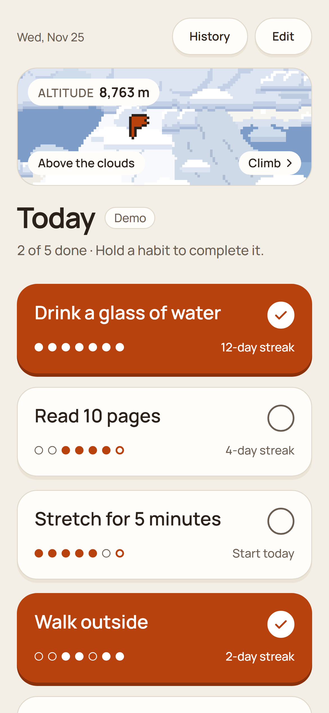
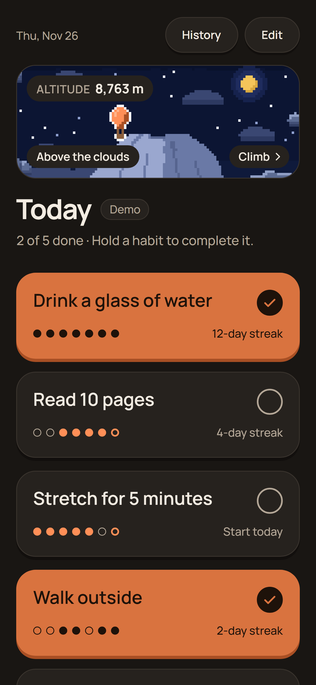

# Ascend

**A habit tracker you press like a physical key, where your habits carry a
balloon up a mountain and into space.**

**Live:** [ascend-dk.vercel.app](https://ascend-dk.vercel.app). Try the demo, no email needed.

<p align="center">
  
</p>

Full tour (sign in, the Summit, History, then Climb up into space):
[light](design/videos/ascend-demo-light.mp4) ·
[dark](design/videos/ascend-demo-dark.mp4)

<p align="center">
  
  &nbsp;
  
</p>

## What it does

- **Press-and-hold keys.** Each habit is a big key: hold it to complete it (a
  fill grows under your finger, a small pop when it's done); tap a done key to
  undo. "Tap to complete" is in Settings for anyone who can't hold.
- **Streaks.** Every habit shows its streak and the last seven days as dots.
- **History.** 7, 30 or 90 days: completion rate, current and longest
  streaks, a bar per day you can scrub, and a row of dots per habit.
- **The Climb.** Your habits add altitude: 100 m for a full day, plus a bonus
  for a perfect one, and missed days never take any away. A pixel-art hot-air
  balloon rises past a Fuji-like mountain, crosses the Summit at 8,848 m, then
  climbs through the clouds into the stratosphere and space. Named zones keep
  coming (Moonlight, Asteroid belt, Nebula…), and space repeats forever, so
  there's no finish line.
- **Install to the home screen.** It has its own icon, runs full screen, and
  matches the status bar in light and dark.
- **Accessible.** 44 px targets, tested contrast, Reduce Motion respected,
  keyboard and VoiceOver support (holds work with Space or Enter).

## Interesting decisions

All of them, with the reasons, are in [`plans/habit-tracker.md`](plans/habit-tracker.md).

- **Streaks are derived, never stored.** A SQL function counts them from
  check-ins, and a test checks it agrees with the TypeScript version on
  hundreds of random histories.
- **Altitude is derived the same way.** `habit_altitude()` in Postgres and
  `lib/altitude.ts` implement one rule, and a test runs both on 200 random
  histories in five time zones, so they can't drift apart.
- **A check-in is a calendar day in your time zone**, never a timestamp, so
  23:30 in Toronto can't land on tomorrow in UTC. The server accepts today,
  or yesterday within 10 minutes of midnight.
- **The hold gesture is a pure state machine** (`lib/hold.ts`), tested event
  by event: auto-repeating keys, Android's long press with no click after it,
  a finger that drifts into a scroll.

## How I built it

Every feature went through the same loop, with three read-only review agents
(`.claude/agents/`):

1. Plan the feature in [`plans/habit-tracker.md`](plans/habit-tracker.md).
2. **logic-checker** reviews the plan for edge cases (midnight, time zones,
   streak breaks) before any code is written.
3. Build it with tests.
4. **code-reviewer** (bugs, security, accessibility, missing tests) and
   **design-critic** (Playwright screenshots at iPhone size, light and dark)
   review in parallel.
5. Fix what's real, commit, and log every finding, its severity and what was
   done about it under **Reviews** in the plan.

**Tests:** 600+ unit and database tests (Vitest, with the migrations run
against real Postgres in PGlite) and 90+ browser tests (Playwright with axe,
on an iPhone-sized screen).

**Stack:** Next.js 16 (App Router, Cache Components) · React 19 · TypeScript ·
Tailwind CSS 4 · Supabase (Postgres, auth, row-level security) · Vercel.

## Run it locally

```bash
npm install
cp .env.example .env.local   # then fill in the four values
npm run dev                  # http://localhost:3000
```

| Variable | What |
|---|---|
| `NEXT_PUBLIC_SUPABASE_URL` | the Supabase project URL |
| `NEXT_PUBLIC_SUPABASE_PUBLISHABLE_KEY` | the publishable (anon) key; safe in the browser, limited by RLS |
| `DEMO_EMAIL`, `DEMO_PASSWORD` | the demo account (server-only); leave unset to hide "Try the demo" |

**Database:** paste each file in [`supabase/migrations/`](supabase/migrations/)
into the Supabase SQL editor, in name order, and run each once. In
Authentication → URL Configuration, add `http://localhost:3000/auth/confirm`
and your production `/auth/confirm` to Redirect URLs.

```bash
npm test             # unit + database tests
npm run test:e2e     # Playwright on an iPhone-sized browser, with axe (needs .env.local)
npm run screens      # screenshots in docs/screenshots/
npm run record:demo  # the demo videos in design/videos/, on production (needs ffmpeg or FFMPEG_PATH)
```
