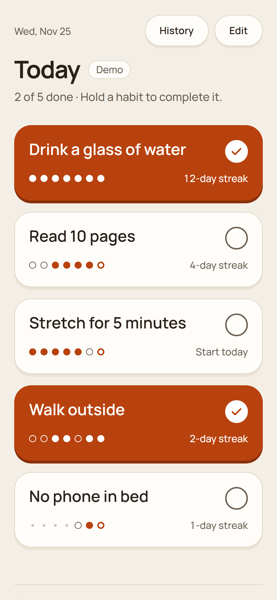
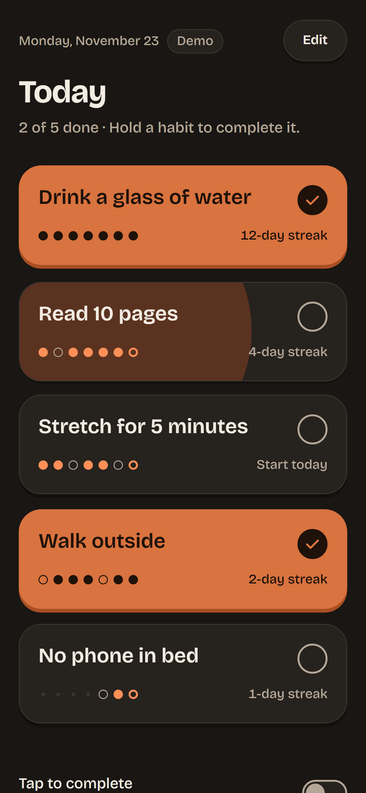
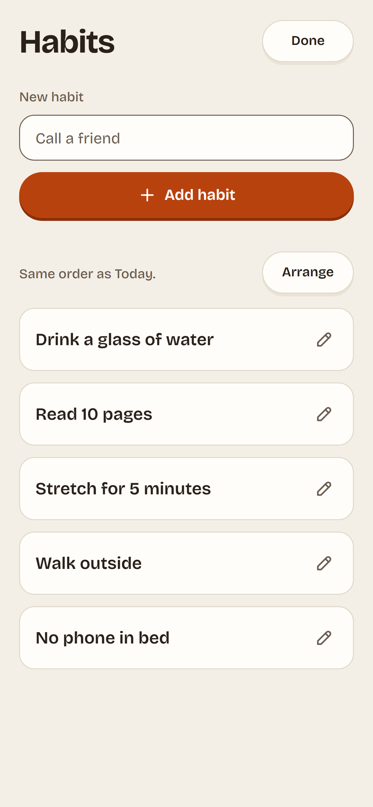

# Hold

**Habits you press and hold.** Each habit is a big key: press and hold it to
complete it (a fill grows out from under your finger, a small pop when it's
done), tap it again to undo. Every habit shows its streak and the last seven
days as dots. Mobile-first, installable to the home screen.

**Live:** [habit-tracker-ifaf.vercel.app](https://habit-tracker-ifaf.vercel.app) · Tap **Try the demo** on the
login screen: a shared account with sample habits, no email needed.

| Today | Mid-hold | Habits |
|---|---|---|
|  |  |  |

## What it does

- **Today**: press and hold a habit for 0.65 s to complete it; tap a done one
  to undo. The streak and the week of dots update at once, and the server
  confirms. "Tap to complete" is a switch for anyone who can't hold.
- **Habits**: add, rename, delete (with an inline confirmation), and reorder
  with an Arrange mode (up and down on every row, Move to top and bottom).
- **Login**: a one-time code by email (works inside the iPhone home-screen
  app, where email links don't), or **Try the demo**.
- **Installable**: its own icon and name, full screen, status bar matched in
  light and dark.
- **Accessible**: real buttons with states for screen readers, 44 px targets,
  4.5:1 contrast (tested), Reduce Motion respected, keyboard holds with
  Space or Enter.

## How it's built

Next.js 16 (App Router, Cache Components) · React 19 · TypeScript ·
Tailwind CSS 4 · Supabase (Postgres + auth, row-level security) · Vercel.

A few decisions worth knowing (all of them, with reasons, are in
[`plans/habit-tracker.md`](plans/habit-tracker.md)):

- A check-in is a **calendar day in your timezone**, never a timestamp, so
  23:30 in Toronto can't land on tomorrow in UTC.
- **Streaks are derived**, never stored: a SQL function counts them, and a
  test checks it agrees with the TypeScript version on hundreds of random
  histories.
- **Saves never toggle**: "done" or "not done", so a double tap or a retry
  can't flip the wrong way. The screen updates optimistically and the
  server's answer replaces the guess.
- **Own rows only**: row-level security on every table, privileges written
  revoke-then-grant, limits in the database (100 habits, a check-in date
  window), and no service-role key anywhere. The migration is tested against
  real Postgres (PGlite) with Supabase's roles.
- The press-and-hold gesture is a **pure state machine** (`lib/hold.ts`),
  tested event by event: auto-repeating keys, a long press with no click
  after it on Android, a finger that drifts into a scroll.

## Built with three review agents

Every feature went through the same loop: plan → **logic-checker** (reviews
the plan for edge cases before any code) → build with tests →
**code-reviewer** and **design-critic** (Playwright screenshots at iPhone
size, light and dark) in parallel → fix what's real → commit. The agents are
read-only (`.claude/agents/`). Every finding, its severity, and what was done
about it is logged under **Reviews** in
[`plans/habit-tracker.md`](plans/habit-tracker.md).

## Run it locally

```bash
npm install
cp .env.example .env.local   # then fill in the four values
npm run dev                  # http://localhost:3000
```

### Environment

| Variable | What |
|---|---|
| `NEXT_PUBLIC_SUPABASE_URL` | the Supabase project URL |
| `NEXT_PUBLIC_SUPABASE_PUBLISHABLE_KEY` | the publishable (anon) key; safe in the browser, limited by RLS |
| `DEMO_EMAIL`, `DEMO_PASSWORD` | the demo account (server-only); leave unset to hide "Try the demo" |

### Database

Paste [`supabase/migrations/20261123120000_habits.sql`](supabase/migrations/20261123120000_habits.sql)
into the Supabase SQL editor and run it once (one transaction). In
Authentication → URL Configuration, add `http://localhost:3000/auth/confirm`
and your production `/auth/confirm` to Redirect URLs: exact addresses, never
a wildcard on a domain you don't own.

## Tests

```bash
npm test             # Vitest: unit tests + database tests in PGlite (~300)
npm run test:e2e     # Playwright on an iPhone-sized browser, with axe (needs .env.local)
npm run screens      # screenshots in docs/screenshots/
```

Against a deployed copy, `BASE_URL=https://… npx playwright test` runs only
the smoke and install checks (the demo account is shared, so the full suite
stays local).
